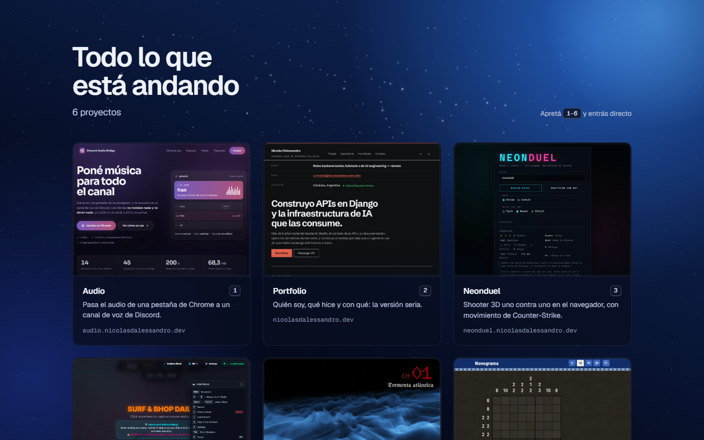

# Hub

La puerta de entrada a todo lo que tengo andando en `nicolasdalessandro.dev`: un recuadro por
proyecto, con su vista previa, y un click o su número para entrar. Está en
[hub.nicolasdalessandro.dev](https://hub.nicolasdalessandro.dev/).



## El objetivo

Tengo varios proyectos publicados en una VPS: juegos, herramientas y el portafolio, cada uno en su
subdominio. El hub los junta en una sola página. De un vistazo ves qué está andando, reconocés cada
proyecto por su imagen y entrás con un click o con su tecla, sin menús de por medio.

Tiene tres reglas:

- **La lista no se mantiene a mano.** Cada proyecto declara su ficha (nombre, descripción, url y
  vista previa, en español y en inglés) en el repo de infraestructura, donde vive su despliegue. El
  deploy de allá junta las fichas en un `catalogo.json` y el hub lo pide al cargar. Un proyecto que
  se publica aparece solo, y uno que se apaga desaparece. El encabezado cuenta los proyectos de
  verdad.
- **Muestra sólo lo que cualquiera puede usar.** Lo que pide permiso, como un servidor con
  whitelist, queda afuera con su motivo anotado en la ficha.
- **Que se sienta del dueño sin estorbar.** Una grilla sobria sobre un cielo azul, con un polvo que
  deriva solo y se enciende por donde pasa el mouse. Nada retro.

## Cómo funciona

- **Sitio estático**, sin backend propio: TypeScript, React 19 y Vite.
- **El catálogo llega en runtime** desde `/catalogo.json`. Si falta, viene roto o trae una ficha que
  no valida, la página sigue andando con lo que pudo leer. El formato de la ficha y del catálogo es
  un contrato con infraestructura ([ADR-0010](docs/adr/0010-formato-de-la-ficha-y-del-catalogo.md)).
- **Español e inglés**, según el idioma del navegador. Ningún texto visible está escrito en un
  componente: todos salen de [`src/i18n/textos.ts`](src/i18n/textos.ts).
- **El fondo** es un `canvas` 2D: motas sembradas con una semilla fija que derivan abajo a la
  izquierda, se encienden con el mouse, dejan estela y se apagan solas. Con
  `prefers-reduced-motion` queda quieto.
- **Accesible:** las teclas 1–9 entran directo, el foco se ve y el fondo queda fuera del árbol de
  accesibilidad.
- **El despliegue:** el `Dockerfile` corre el gate entero y sirve `dist/` con un nginx sin root
  ([`deploy/nginx.conf`](deploy/nginx.conf), con su CSP). Cada push a `main` publica la imagen en
  GHCR y la VPS la baja sola, porque no tiene puertos abiertos: todo entra por un Cloudflare Tunnel.

## Correrlo

```bash
npm install
npm run dev
```

En desarrollo, `/catalogo.json` es el de ejemplo, [`ejemplos/catalogo.json`](ejemplos/catalogo.json).
Las vistas previas de [`public/prueba/vistas/`](public/prueba/vistas/) son capturas sintéticas para
probar, hasta que cada proyecto sirva la suya.

## El gate

```bash
npm run gate
```

Corre tipos, lint, tests y build. Lo corre también el build de la imagen: si falla, no se publica
nada. Necesita Node 24 y nada más.

Un solo archivo, para iterar más rápido:

```bash
npx vitest run tests/hub.test.tsx
```

> **Ojo con los pipes.** `comando | tail -20` devuelve el exit code de `tail`,
> que es siempre 0: te oculta el rojo. Corré sin pipe, o cerrá con
> `; echo "EXIT=$?"`.

## Dónde está cada cosa

| Ruta | Qué hay |
|---|---|
| `src/catalogo/` | Pedir y validar el catálogo: una ficha rota se descarta sin tirar el resto. |
| `src/hub/` | La grilla, los recuadros y el cielo del fondo. |
| `src/i18n/textos.ts` | Todos los textos, en los dos idiomas. |
| `tests/` | Los tests, nombrados por comportamiento. |
| `PRODUCT.md`, `DESIGN.md` | A quién le habla el hub y su sistema de diseño (colores, tipografía, movimiento). |
| `docs/adr/` | Las decisiones y su motivo. |
| `docs/conceptos.md` | Los conceptos que se evaluaron antes de llegar a la grilla. |

## Cómo se construye

Con TDD, un ítem por iteración, y cada decisión importante con su ADR antes del código:

- **Qué falta:** [docs/backlog.md](docs/backlog.md)
- **Qué se hizo y con qué evidencia:** [docs/bitacora.md](docs/bitacora.md)
- **Por qué está así:** [docs/adr/](docs/adr/)

Antes de llegar a la grilla se probaron una sala de fichines y una placa «1000 en 1»; por qué no
quedaron está en [docs/conceptos.md](docs/conceptos.md) y en
[ADR-0011](docs/adr/0011-el-hub-es-una-grilla-de-proyectos.md).

Las iteraciones las corre Claude Code con `/tdd` (el protocolo está en
[.claude/commands/tdd.md](.claude/commands/tdd.md)), sobre el branch `loop/construccion`.
